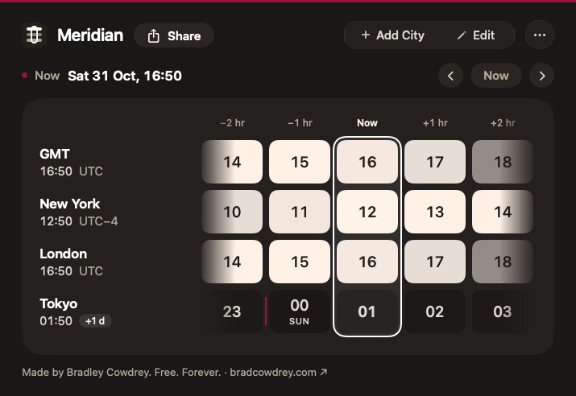
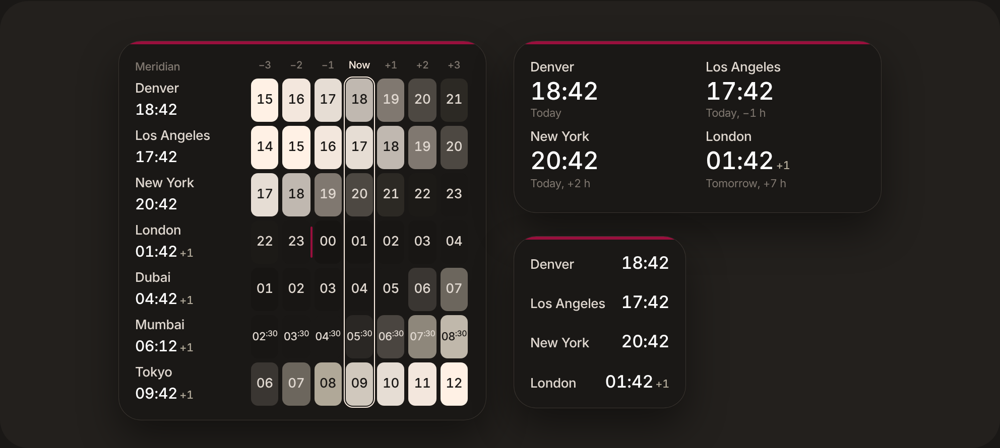

<p align="center"></p>

<h1 align="center">Meridian</h1>
<p align="center"><b>Every time zone at a glance.</b><br>
A tiny, free, open-source world clock for your Mac's menu bar, with a desktop widget.<br>
Made by <a href="https://bradcowdrey.com">Bradley Cowdrey · bradcowdrey.com</a></p>

<p align="center">
  <a href="https://github.com/bradleycowdrey/meridian/releases/latest/download/Meridian.dmg"><b>Download for Mac</b></a> ·
  <a href="https://bradcowdrey.com/meridian">Try it in your browser</a> ·
  <a href="https://github.com/bradleycowdrey/meridian/issues">Report an issue</a>
</p>

<p align="center">
  <a href="https://bradcowdrey.com/meridian"></a><br>
  <sub>Click the picture to try the live demo at <a href="https://bradcowdrey.com/meridian">bradcowdrey.com/meridian</a> (also on <a href="https://bradleycowdrey.github.io/meridian/">GitHub Pages</a>).</sub>
</p>

---

### What's new in 0.7.22

- **Apple's abbreviations**: hours read "hr" ("+1 hr", "In 4 hr 20 min"), as in Apple's Clock.
- **AM and PM, always**, Apple's style ("10:21 PM").
- **"+1 d"** for tomorrow, everywhere.
- **Less crowded**: two hours either side of now, with wider tiles.
- **Hour labels in the panel** read −1 hr, Now, +1 hr, like the widgets.
- **Large widget labels** read −1 hr, Now, +1 hr.
- **Edit Widget shows the cities it follows** (the **Showing** row).
- **Use Meridian's Cities** toggle in **Edit Widget**: follow the app's list, or turn it off to choose the widget's own cities.
- **Labelled hours** on small and medium widgets: −1 hr, Now, +1 hr.
- **Cleaner widgets**: each city shows the hour before, now and the hour after, with bigger times.
- **Choose each widget's cities**: right-click a widget → **Edit Widget** (0.7.10).
- **Bigger, clearer widgets**: small shows one city, medium two, large four (0.7.10).
- **The widget shows up after updating**, with no Terminal needed (0.7.9).
- **The desktop widget appears in Edit Widgets** (0.7.8).
- **Share** now sits in the panel's top bar, next to the Meridian name.
- **Panel opens centred under Meridian's menu bar item.**
- **Signed and notarized by Apple**: no more "can't verify the developer" warning.
- **Widget fix**: Meridian keeps macOS pointed at the right copy of its widget, with a **Refresh Widgets** button in Settings.
- **Desktop widget** in small, medium and large ([see below](#desktop-widget)).
- **Safer updates**: verified downloads, and a clear message if an update can't install.
- **Time travel stays put** when the clock passes the hour, and the app refreshes when your Mac changes time zone.
- Dozens of fixes from a full test pass at all five sizes.

Meridian updates itself once a day. Full history: [CHANGELOG.md](CHANGELOG.md).

---

Meridian lines up your cities as day-and-night ribbons on one grid. Every column is the same
instant everywhere, so the line through the middle is *now*.

## Features

- **Day/night ribbons**: night navy, dawn peach, daylight sand and dusk orange, one row per city.
- **Time travel**: drag the strip, scroll, press ← →, or click any hour. **Now** snaps back.
- **Meeting overlap**: a cream mark shows hours when every city is inside working hours.
- **Copy the moment**: one click copies the selected time for every city, ready to paste into a chat or invite.
- **Easy to manage**: **Add** opens search right in the panel; **Edit** shows a delete button and a drag handle on every city.
- **Fast search**: city names, airport codes (`SFO`, `LHR`), abbreviations (`PST`, `CET`) or offsets (`UTC+5:30`).
- **The details**: day-change markers, half-hour and 45-minute zones, a `+1 d` badge, 12/24-hour time, custom city names, drag to reorder.
- **Desktop widget**: small, medium and large widgets for the desktop or Notification Center, small shows one city, medium two, large four with the day/night tiles; right-click a widget → **Edit Widget** to choose its cities. Right-click the desktop → **Edit Widgets** → search **Meridian**.
- **Menu bar first**: show an icon, or a city and its time (`LON 14:32`). Open it as a desktop window that can float above everything.
- **Five sizes** (Extra Small to Extra Large, ⌘+ / ⌘−) and a choice of **SF Pro** or **Inter**, the typeface of bradcowdrey.com.
- **Automatic updates**: Meridian checks GitHub Releases once a day, verifies the download's SHA-256, then installs and restarts in one click. Turn it off or check manually in **Settings → General → Updates** or the ⋯ menu.
- Open at login. No account, no tracking, no network access. About 1 MB.

Native SwiftUI, universal binary (Apple silicon + Intel), macOS 14 Sonoma or later.

## Desktop widget

<p align="center"></p>

Add Meridian to your desktop or Notification Center in three sizes: small (one city), medium (two cities) and large (four cities), each showing the hour before, now and the hour after as day-and-night tiles. It follows the cities and order you set in the app, or right-click it, choose **Edit Widget** and turn off **Use Meridian's Cities** to pick its own. Right-click the desktop, choose **Edit Widgets**, then search for **Meridian**. If it isn't listed, open Meridian from Applications, choose Settings → **Refresh Widgets**, then close and reopen Edit Widgets.

## Install (sideload)

Meridian is distributed directly, not through the Mac App Store.

1. Download [Meridian.dmg](https://github.com/bradleycowdrey/meridian/releases/latest/download/Meridian.dmg) (all versions are on [Releases](https://github.com/bradleycowdrey/meridian/releases))
   or [bradcowdrey.com/meridian](https://bradcowdrey.com/meridian), where you can also try it in your browser.
2. Open the DMG and drag **Meridian** to **Applications**.
3. Click the globe in your menu bar, then **Add** your cities.
4. Optional: right-click your desktop, choose **Edit Widgets**, and add **Meridian**.

## Build from source

Requires Xcode 15.3+ (Swift 5.10) on macOS 14+.

```sh
git clone https://github.com/bradleycowdrey/meridian.git
cd meridian
swift run                         # run in development
scripts/build-app.sh 0.1.0        # dist/Meridian.app (universal)
scripts/make-dmg.sh 0.1.0         # dist/Meridian-0.1.0.dmg
```

## Releasing

Bump the number in `VERSION` and push to `main`. GitHub Actions builds a universal app, packages a DMG and publishes it as release `v<VERSION>`, plus a stable `Meridian.dmg` that the download links always point to.

Optional secrets for Developer ID signing and notarization (removes the Gatekeeper prompt):
`DEVELOPER_ID_P12` (base64 .p12), `DEVELOPER_ID_P12_PASSWORD`, `CODESIGN_IDENTITY`,
`NOTARY_APPLE_ID`, `NOTARY_PASSWORD` (app-specific password), `NOTARY_TEAM_ID`.
Without them, builds are ad-hoc signed.

## Layout

```
Sources/Meridian/
  MeridianApp.swift       Menu bar, desktop window, settings
  Brand.swift             Name, author and links: rebrand here
  Model/                  Cities, search directory, settings and time maths
  Views/StripView.swift   The ribbons
  Views/ClockPanel.swift  Header, time-travel bar, add-city search
docs/                     Download page with a live web demo
```

## Terms and privacy

Using Meridian means agreeing to the [Terms of Use and Privacy](TERMS.md) (also at [bradcowdrey.com/legal](https://bradcowdrey.com/legal)), which cover every app, AI skill, book and page Bradley Cowdrey publishes. In short: it's free and provided as is, you use it at your own risk, and your cities stay on your Mac. The app asks you to agree the first time it opens, and ⋯ → **Terms & Privacy** opens them any time.

## License

MIT © 2026 Bradley Cowdrey · [bradcowdrey.com](https://bradcowdrey.com)

Bundles the [Inter](https://rsms.me/inter/) typeface by Rasmus Andersson under the SIL Open Font License 1.1 (`Resources/Fonts/Inter-LICENSE.txt`).
